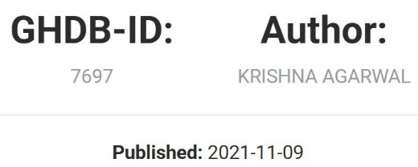
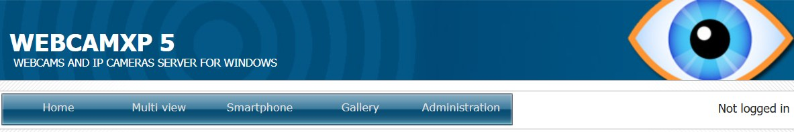

# GHDB Footprinting Lab

**Week 2 · Project Module 2 · Passive Reconnaissance / Google Dorking**

This report presents the footprinting exercise as one continuous flow: GHDB fundamentals, publicly indexed camera listing observations, mathematics PDF findings, and the lessons learned.

## Part 1 — GHDB and Footprinting Method

**Objective:** Learn what search engines reveal about publicly indexed websites, devices, and files.

**Method:** Review search operators including `intitle:`, `inurl:`, `site:`, and `filetype:`. Record the URL and what was visible while distinguishing observed information from assumptions about exposure.

**GHDB screenshot evidence**

[Open the GHDB screenshot](evidence/ghdb-entry.jpg) · [GHDB reference](https://www.exploit-db.com/google-hacking-database)

**Finding:** Google search operators can narrow publicly indexed results, but indexing alone does not confirm a vulnerability.

## Part 2 — Camera Footprinting Findings

**Objective:** Record ten publicly listed camera references as part of the footprinting exercise.

**Method:** The student reports opening the ten Insecam listings and viewing feeds during the lab. The observations have not been independently checked. Listing IDs are not direct device IP addresses, and credentials were not collected.

**Existing webcam interface screenshot**

[Open the webcam interface screenshot](evidence/webcam-interface.jpg)

This screenshot illustrates a web camera interface but does not independently verify all ten Insecam listings.

### Camera findings table

| No. | Clickable camera listing | Observation | Username / Password |
|---|---|---|---|
| 1 | [Insecam listing 1012712](http://www.insecam.org/en/view/1012712/) | Student-reported visible feed; not independently verified | Not supplied |
| 2 | [Insecam listing 1012784](http://www.insecam.org/en/view/1012784/) | Student-reported visible feed; not independently verified | Not supplied |
| 3 | [Insecam listing 1012770](http://www.insecam.org/en/view/1012770/) | Student-reported visible feed; not independently verified | Not supplied |
| 4 | [Insecam listing 1012776](http://www.insecam.org/en/view/1012776/) | Student-reported visible feed; not independently verified | Not supplied |
| 5 | [Insecam listing 1012769](http://www.insecam.org/en/view/1012769/) | Student-reported visible feed; not independently verified | Not supplied |
| 6 | [Insecam listing 1012766](http://www.insecam.org/en/view/1012766/) | Student-reported visible feed; not independently verified | Not supplied |
| 7 | [Insecam listing 1012760](http://www.insecam.org/en/view/1012760/) | Student-reported visible feed; not independently verified | Not supplied |
| 8 | [Insecam listing 1012752](http://www.insecam.org/en/view/1012752/) | Student-reported visible feed; not independently verified | Not supplied |
| 9 | [Insecam listing 1012735](http://www.insecam.org/en/view/1012735/) | Student-reported visible feed; not independently verified | Not supplied |
| 10 | [Insecam listing 1012730](http://www.insecam.org/en/view/1012730/) | Student-reported visible feed; not independently verified | Not supplied |

**Relevant query (illustrative, not a verified GHDB entry):** `site:insecam.org/en/view/ "IP camera"`

**Our findings:** Ten listings were documented, and the student reports having viewed camera feeds. Current accessibility, authorization, and underlying camera security settings were not confirmed. Public camera viewing can create privacy and information exposure risks.

**What we learned:** A publicly listed endpoint or page is not the same as proof of a vulnerable device. Good footprinting distinguishes user observations, screenshots, credentials, and verified technical findings.

## Part 3 — Mathematics PDF Footprinting Findings

**Objective:** Document ten public mathematics PDF resources or collections and relevant search queries, using the assignment format.

**Method:** The records include academic directory examples, lecture-note collections, and freely offered textbooks. The linked items are not all directory indexes, and some link to catalog pages. Relevant dorks are examples, not confirmed official GHDB entries.

## Footprinting findings

| No. | PDF resource / listing | Relevant Google dork | Username / Password (if any) | Observation |
|---|---|---|---|---|
| 1 | [Skyline University mathematics directory](https://www.skylineuniversity.ac.ae/pdf/math/) | `intitle:index.of "parent directory" mathematics pdf` | — | Instructor's directory-listing example |
| 2 | [UW–Madison free lecture notes](https://people.math.wisc.edu/~angenent/Free-Lecture-Notes/) | `site:wisc.edu mathematics "PDF" "calculus"` | None indicated | Public lecture-note collection |
| 3 | [UW–Madison Elementary Calculus](https://people.math.wisc.edu/~hkeisler/calc.html) | `site:wisc.edu "Elementary Calculus" pdf` | None indicated | Open mathematics textbook page |
| 4 | [American Institute of Mathematics open textbooks](https://textbooks.aimath.org/textbooks/approved-textbooks/) | `site:aimath.org "open textbooks" pdf` | None indicated | Curated open-textbook collection |
| 5 | [OpenStax College Algebra 2e](https://openstax.org/books/college-algebra-2e/pages/preface) | `site:openstax.org "College Algebra 2e" pdf` | None indicated | Free textbook page with PDF option |
| 6 | [OpenStax Precalculus 2e](https://openstax.org/books/precalculus-2e/pages/preface) | `site:openstax.org "Precalculus 2e" pdf` | None indicated | Free textbook page with PDF option |
| 7 | [OpenStax Introductory Statistics 2e](https://openstax.org/books/introductory-statistics-2e/pages/1-introduction) | `site:openstax.org "Introductory Statistics 2e" pdf` | None indicated | Free textbook page with PDF option |
| 8 | [OpenStax Calculus Volume 1](https://openstax.org/subjects/math) | `site:openstax.org "Calculus Volume 1" pdf` | None indicated | Mathematics catalog, book link not individually checked |
| 9 | [OpenStax Algebra and Trigonometry 2e](https://openstax.org/subjects/math) | `site:openstax.org "Algebra and Trigonometry 2e" pdf` | None indicated | Mathematics catalog, book link not individually checked |
| 10 | [OpenStax mathematics textbook collection](https://openstax.org/subjects/math) | `site:openstax.org/subjects/math textbooks pdf` | None indicated | General catalog; overlaps with entries 5–9 |

**Verification limitation:** These are ten table entries, but entries 8–10 use the same collection URL and entry 10 is not a distinct book. The list contains a mix of indexes, textbook pages, and catalogs—not ten separately validated directory listings. Current accessibility from the student's network was not tested.

## Overall Findings and What We Learned

1. Google dorking can help locate indexed interfaces and published files.
2. Search results, observed web pages, and screenshots provide different levels of evidence.
3. Accessible educational PDFs are generally legitimate resources; their visibility does not imply a security flaw.
4. Security assessments must respect authorization and privacy, especially with third-party camera feeds.
5. We should preserve clear links, record uncertainty, and avoid claiming live verification without dated evidence.

## Evidence and References

- [GHDB screenshot](evidence/ghdb-entry.jpg)
- [Webcam interface screenshot](evidence/webcam-interface.jpg)
- [Google Hacking Database](https://www.exploit-db.com/google-hacking-database)
- [Full Part 3 working notes](PART-3-MATH-PDF-FOOTPRINTING.md)

No individual screenshots of all ten camera feeds or ten mathematics resource pages were supplied; the embedded images above are the available original evidence.

## Course Credit

Thanks to NetworkWalks for the lab guidance.
